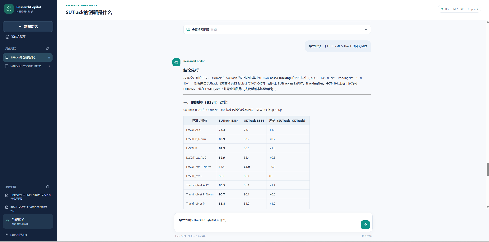
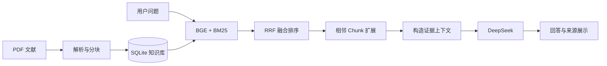

# ResearchCopilot 📚

**面向科研论文的 RAG（Retrieval-Augmented Generation）智能问答系统**，支持 PDF 文献管理、混合检索、上下文扩展、基于证据的问答以及历史会话管理。

> **在线演示为静态 Demo**：展示真实项目的 React 页面设计和预设问答交互，不连接 FastAPI、SQLite 或 DeepSeek，不提供在线实时推理。完整 RAG 功能需在本地启动后端。

### 🌐 在线体验

**[▶ 打开 ResearchCopilot 在线 Demo](https://sunnychen111.github.io/ResearchCopilot/)** · **[查看 React 前端源码](./frontend/)** · **[查看 RAG 后端入口](./backend/api_main.py)**

## 🖥️ 界面预览

<!-- 请先将完整网页截图上传至 docs/screenshots/researchcopilot-demo.png，再取消下一行的注释。 -->


在线 Demo 可切换 **OSTrack**、**DUTrack** 等预设论文问答，体验 Markdown 表格展示、文献来源标记和双层检索证据折叠。上述问答为公开演示样例，并非实时模型输出。

## ✨ 核心功能

| 模块 | 功能 | 在线 Demo |
| --- | --- | --- |
| 论文问答 | 使用 DeepSeek 根据检索证据回答问题，支持 Markdown 展示 | 预设回答 |
| 文献管理 | PDF 上传、解析、分块及文献列表管理 | 静态示例 |
| 混合检索 | BGE 语义检索 + BM25 关键词检索 + RRF 排名融合 | 展示示例证据 |
| 上下文增强 | 检索命中 Chunk 后，扩展同篇论文相邻 Chunk | 展示示例内容 |
| 来源追溯 | 展示文献文件名、页码、Chunk 以及检索来源 | 可交互展开 |
| 会话管理 | 使用 SQLite 保存历史会话与问答证据 | 预设话题切换 |

## 🧱 技术栈

- **前端**：React、Vite、React Markdown、remark-gfm、Lucide Icons
- **后端**：Python、FastAPI、SQLAlchemy、SQLite
- **文献处理**：PyMuPDF、结构化文本分块
- **检索**：BGE (`BAAI/bge-small-zh-v1.5`)、BM25、RRF、Neighbor Chunk Expansion
- **生成**：DeepSeek API（仅完整后端模式）
- **部署**：GitHub Pages + GitHub Actions（静态 Demo）

## 🔍 RAG 工作流程



## 🚀 本地体验静态 Demo

要求：Node.js 与 npm。

```bash
cd frontend
npm ci
```

**Windows PowerShell：**

```powershell
$env:VITE_DEMO_MODE = "true"
npm run dev
```

然后打开终端给出的本地网址（通常为 `http://localhost:5173/`）。无需运行 Python 后端。测试后可用 `Remove-Item Env:VITE_DEMO_MODE` 清除环境变量。

**真实 RAG 模式**：默认执行 `npm run dev` 启动正式前端，并按后端代码配置 Python 依赖、SQLite 文献库与 `.env` 中的 `DEEPSEEK_API_KEY`、`DEEPSEEK_MODEL`，通过 FastAPI 提供接口。请勿将真实 API Key、数据库或私有论文上传到公开仓库。

## 📂 项目入口

- [`frontend/src/App.jsx`](./frontend/src/App.jsx)：连接真实 FastAPI 的聊天界面
- [`frontend/src/DemoApp.jsx`](./frontend/src/DemoApp.jsx)：GitHub Pages 静态演示页面
- [`frontend/src/main.jsx`](./frontend/src/main.jsx)：正式模式 / Demo 模式入口切换
- [`api_main.py`](./api_main.py)：FastAPI 服务入口
- [`sqlite_retrieval.py`](./sqlite_retrieval.py)：BGE + BM25 + RRF 混合检索
- [`rag_context.py`](./rag_context.py)：相邻 Chunk 上下文扩展
- [`rag_sqlite.py`](./rag_sqlite.py)：检索结果与 DeepSeek 问答集成

## 📌 说明

本项目主要用于科研文献问答应用的工程学习与展示。在线页面是静态交互演示，回答和检索证据来自预设样例；不应将其理解为已部署的在线实时 RAG 服务。
