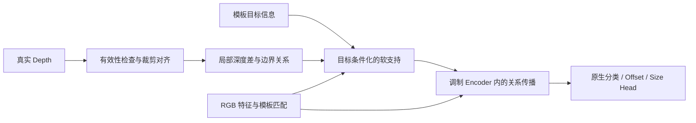

# 深度如何辅助 RGB：几何传播、目标边界与任务相关可信度

> 阅读总结与研究建议｜2026-10-24  
> 面向项目：单主干、无独立 Depth 编码器的 RGB-D 单目标跟踪  
> 本次交付仅包含文献阅读与方案分析；未连接 GPU、未轮询当前测试、未修改模型或训练配置。

## 摘要

本报告围绕三个问题整理 22 篇文献：深度通过什么机制改善 RGB 表征，深度何时有帮助，以及哪些机制适合迁移到当前跟踪项目。证据横跨目标检测、语义分割、实例分割、显著目标检测、视觉表征学习和跟踪。已有研究表明，深度可以直接改变卷积邻域、注意力分配及实例分组，而不必先经过独立的深度特征骨干。边界突变与区域完整性具有借鉴价值，但几何边界不等于目标身份，图像级深度质量也不等于当前目标处的贡献。针对当前项目，更值得检验的是：利用目标条件化的局部几何关系约束 Encoder 内的信息传播，并分别判断测量有效性、目标可分性和相对 RGB 的增益。本报告区分原文事实、跨论文推论与待验证方案，不将其他任务上的成绩直接视为跟踪有效性的证据。

## 1. 研究问题与术语

### 1.1 本次需要回答的问题

- **RQ1：Depth 到底给 RGB 提供什么？** 除候选重排序外，哪些信号能参与特征形成、目标分组和边界恢复？
- **RQ2：什么时候应该相信 Depth？** 测量可靠、几何可分和任务有收益，是否是同一件事？
- **RQ3：如何迁移到我们的跟踪器？** 在不增加独立 Depth 编码器的条件下，如何利用这些机制，并避开此前 RGB-T 实验暴露的搜索区域、目标身份和回归问题？

这三个问题决定了报告的组织方式。文献数量不是目标，重点是找到能够改变下一轮实验判断的证据。

### 1.2 “无编码器”应当怎样表述

本报告采用的工程约束是：**不增加把 Depth 图独立编码为高维特征序列的可学习网络**。允许从原始 Depth 解析计算有效掩码、深度差、局部统计和几何关系，再用少量可学习参数调制 RGB 特征。

需要区分三种情况：

| 情况 | 是否满足上述约束 | 说明 |
|---|---|---|
| 原始 Depth → 解析几何关系 → RGB 卷积或注意力 | 满足 | 可以有可学习的调制强度，但不另建 Depth 特征骨干 |
| RGB 和 Depth 共享权重、分别经过同一编码器 | 不等于满足 | 参数共享并不免除 Depth 的编码计算 |
| Depth → 小型 CNN、点云 DGCNN 或 patch MLP → Prompt | 含可学习深度编码 | 可以很轻，但不能据此宣称完全没有 Depth 编码器 |

“没有第二个完整 Backbone”“参数量较少”“Depth 不经过独立编码”是不同主张，后续写论文时应分别说明。

## 2. 检索与证据范围

检索截止日期为 **2026-10-24**。围绕几何算子与注意力、边界与目标分组、可靠性与负迁移、跟踪与时间传播四个视角交叉检索，再回到论文、作者发布版本和官方实现核对。采用定向综述方式，不声称穷尽全部 RGB-D 文献。

纳入的 22 篇文献按实际阅读条件分为：

- **F：18 篇。** 获得完整原文，阅读与本议题相关的方法、消融及局限部分；不表示每篇都逐页精读了全部附录。
- **P：2 篇。** 只获得部分原文或可检索正文，并核对官方代码／说明。
- **A：2 篇。** 只获得出版商摘要、引言或方法概览，未取得完整正文。此类文献只用于确认公开主张和相近方向，不推断未公开细节。

具体章节、原文入口和阅读限制见同目录的 `paper_reading_ledger.md` 与 `paper_reading_ledger.json`。下载清单只记录实际归档的 PDF，不能把阅读篇数当作本地 PDF 数量。

两个边界说明：

1. 你先前介绍的 **DPGTrack**，本次没有获得能够独立核验的公开原文及完整书目信息，因此没有把你的摘要当成已核实论文证据。这不表示该论文不存在。
2. **DPTracker 是另一篇已核实文献**，名称接近，但不能与 DPGTrack 混用。其阅读证据目前为 A 级。

## 3. 文献地图：按 Depth 承担的主要功能分类

为便于比较，下面按主要研究作用归类；一篇论文可能同时涉及多个作用。F/P/A 是阅读完整程度，不是论文质量评分。

| 编号 / 方法 | 年份与主题 | Depth 的主要作用 | 编码方式核对 | 阅读 |
|---|---|---|---|---|
| [1] [HHA](https://arxiv.org/abs/1407.5736) | 2014；几何表达 | 将深度转换为视差、离地高度和法线相对重力方向角；几何边界也参与区域提议 | RGB / HHA 双编码器 | F |
| [2] [Depth-aware CNN](https://www.ecva.net/papers/eccv_2018/papers_ECCV/html/Weiyue_Wang_Depth-aware_CNN_for_ECCV_2018_paper.php) | 2018；几何约束传播 | 用邻域深度差重加权卷积和池化，改变 RGB 特征传播 | 基础 D-CNN 直接利用原始深度，无独立 Depth 编码器 | F |
| [3] [Malleable 2.5D](https://www.ecva.net/papers/eccv_2020/papers_ECCV/html/3295_ECCV_2020_paper.php) | 2020；几何约束传播 | 将相对深度关系转换为可学习的软核分配，适应不同深度感受野 | 无独立 Depth 特征编码器；含可学习核分配 | F |
| [4] [DFormerv2](https://openaccess.thecvf.com/content/CVPR2025/html/Yin_DFormerv2_Geometry_Self-Attention_for_RGBD_Semantic_Segmentation_CVPR_2025_paper.html) | 2025；几何约束注意力 | 把 patch 深度差与空间距离作为几何关系，调制自注意力 | 原始 Depth 生成几何先验，无独立 Depth 特征编码器 | F |
| [5] [DFormer++](https://ieeexplore.ieee.org/document/11365989/) | 2026；统一表征 | RGB-D 预训练与统一结构处理模态编码失配 | 统一骨干仍含可学习 Depth 嵌入与特征流 | P |
| [6] [DINOcular](https://arxiv.org/abs/2608.27226v2) | 2026；几何与外观表征 | 以 3D RoPE 和局部深度嵌入学习视觉空间表示，并用 Depth dropout 缓解几何依赖 | 单骨干；含轻量 intra-patch Depth 编码 | F |
| [7] [PDFNet](https://openaccess.thecvf.com/content/CVPR2026/html/Liu_High-Precision_Dichotomous_Image_Segmentation_via_Depth_Integrity-Prior_and_Fine-Grained_Patch_CVPR_2026_paper.html) | 2026；目标完整性与边界 | 利用伪深度完整性及边界约束辅助精细前景分割 | 单目深度生成器 + 共享主编码器处理 RGB/Depth + patch 分支 | F |
| [8] [DANet](https://research.polyu.edu.hk/en/publications/a-single-stream-network-for-robust-and-real-time-rgb-d-salient-ob/) | 2020；目标区域与注意力 | 单流网络配合 Depth / mask 引导的注意力，而非独立 RGB/Depth 双骨干 | RGB-D 四通道单流，联合编码 Depth | F |
| [9] [DSA²F](https://openaccess.thecvf.com/content/CVPR2021/html/Sun_Deep_RGB-D_Saliency_Detection_With_Depth-Sensitive_Attention_and_Automatic_Multi-Modal_CVPR_2021_paper.html) | 2021；深度分层区域 | 由深度直方图模式构建区域掩码，调制 RGB 特征后残差融合 | DSAM 可直接用原始 Depth；完整模型另有轻量 DepthNet | F |
| [10] [UCN](https://proceedings.mlr.press/v155/xiang21a.html) | 2021；实例分组 | 学习实例内紧凑、实例间可分的 RGB-D 像素嵌入，并聚类生成实例 | 对比早期/后期融合；较佳后期融合使用双流 | F |
| [11] [UOIS-Net](https://arxiv.org/abs/2007.08073) | 2021；几何分组与 RGB 细化 | 深度中心投票产生粗实例，RGB 进一步细化区域 | Depth Seeding Network + RGB Region Refinement，多网络 | F |
| [12] [D³Net](https://mftp.mmcheng.net/Papers/20TNNLS_RgbdBench.pdf) | 2021；模态回退 | 以输出一致性判断是否回退 RGB-only 结果 | RGB / Depth / RGB-D 多专家 | F |
| [13] [DQSD](https://arxiv.org/abs/2008.04159) | 2021；局部贡献判断 | 借助 RGB/Depth 显著性预测与训练 GT 构造像素级深度贡献监督 | RGB / Depth 与贡献评估子网 | F |
| [14] [UCTNet](https://www.ecva.net/papers/eccv_2022/papers_ECCV/html/7082_ECCV_2022_paper.php) | 2022；传感不确定性 | 根据深度不确定性抑制不可靠 token 向外传播信息 | RGB / Depth 双 Swin 编码器 | F |
| [15] [DCF](https://openaccess.thecvf.com/content/CVPR2021/html/Ji_Calibrated_RGB-D_Salient_Object_Detection_CVPR_2021_paper.html) | 2021；深度校准 | 使用与分割表现相关的质量标签，并结合原始和估计深度 | 质量分类、Depth 估计和 RGB-D 特征子网 | P |
| [16] [FCFNet](https://eprints.whiterose.ac.uk/id/eprint/201658/) | 2024；任务相关深度质量 | 区分视觉上差的深度与前景不一致的深度，进行特征校准 | RGB / 原始 Depth / 伪 Depth 三流，并含生成器 | F |
| [17] [Any2Seg](https://www.ecva.net/papers/eccv_2024/papers_ECCV/html/4978_ECCV_2024_paper.php) | 2024；模态适应 | 以局部模态关系和共享表示处理不同可用模态 | 各模态复用同权重编码器；仍需处理每路输入 | F |
| [18] [DegMamba](https://www.sciencedirect.com/science/article/pii/S0031320326008861) | 2026；反向辅助的负迁移 | 退化感知融合筛选有用 RGB 信息，减轻深度重建中的纹理复制 | RGB 引导 Depth 超分辨率，非无编码器 RGB 跟踪方法 | A |
| [19] [DAL](https://arxiv.org/abs/1912.00660) | 2019；几何跟踪与恢复 | 深度约束非平稳相关滤波，并以时间深度分布辅助目标在场判断和重检测 | 深度调制 RGB 滤波；非独立 Depth 特征骨干 | F |
| [20] [Depth Attention](https://openaccess.thecvf.com/content/ACCV2024/html/Liu_Depth_Attention_for_Robust_RGB_Tracking_ACCV_2024_paper.html) | 2024；输入调制 | 用目标深度的稳健统计筛选区域，调制 RGB 输入，并结合响应统计 | 包含 Lite-Mono 深度估计器；下游统计调制不需完整 Depth 特征骨干 | F |
| [21] [3DPT](https://openaccess.thecvf.com/content/ACCV2024/html/Li_3D_Prompt_Learning_for_RGB-D_Tracking_ACCV_2024_paper.html) | 2024；几何 Prompt | 冻结 RGB 跟踪底座，用点云几何提示提升 RGB-D 跟踪 | 点云 KNN / DGCNN 可学习几何分支 | F |
| [22] [DPTracker](https://www.sciencedirect.com/science/article/pii/S0167865526001224) | 2026；动态模态 Prompt | MEP 评估模态有效性，Dynamic Prompter 调整融合强度 | 冻结 RGB 跟踪器 + 动态 Prompt；完整 Depth 处理细节未核实 | A |

这张表说明，“Depth 辅助 RGB”至少包含四个不同问题：**改变信息传播、形成对象区域、控制有害信息、保持跟踪身份与状态**。只将深度转成一个最终候选分数，覆盖不了这些问题。

## 4. 几何线索怎样进入 RGB 特征形成

### 4.1 从几何表达，到改变邻域，再到改变注意力

HHA 把深度转成较适合识别的几何通道，但原方法仍需对这些通道进行特征编码；Depth-aware CNN 则直接用深度差改变 RGB 卷积和池化的贡献，不必先学习完整 Depth 特征。两者分别代表“表达几何再编码”和“让几何改变 RGB 运算”。 [1](https://saurabhg.web.illinois.edu/pdfs/gupta2014learning.pdf) [2](https://arxiv.org/pdf/1803.06791)

Malleable 2.5D 进一步把固定的深度邻域规则变成可学习的软分配；DFormerv2 则把深度差和空间距离带入 Transformer 的注意力分配。对于当前 SUTrack，更直接的借鉴对象是后两类几何运算机制，而不是把 HHA 当成额外图像重新编码。 [3](https://www.ecva.net/papers/eccv_2020/papers_ECCV/papers/123640545.pdf) [4](https://arxiv.org/html/2504.04701v1)

**本文推论：** 先验进入 Encoder 的价值，可以不是增加“目标在哪里”的一张热图，而是改变“这个位置应当从哪些位置接收信息”。前者主要调节局部响应强弱，后者可能减少目标与背景、目标与干扰物之间的特征污染。

### 4.2 一个需要保留的反例：固定几何规则可能下降

Malleable 2.5D 的 Table 2 在同一 ResNet-50 / DeepLabv3+ 比较框架下报告以下 mIoU。核数不同意味着容量、计算量也不完全一致，因此不能把全部提升归因于“可信度学习”。 [3](https://www.ecva.net/papers/eccv_2020/papers_ECCV/papers/123640545.pdf)

| 算子 | 核数 | NYUDv2 mIoU (%) | Cityscapes mIoU (%) |
|---|---:|---:|---:|
| Baseline | 1 | 44.56 | 79.94 |
| Depth-aware | 1 | 46.69 | 79.01 |
| Malleable 2.5D | 1 | 47.08 | 80.26 |
| 固定 2.5D | 3 | 48.23 | 78.63 |
| Malleable 2.5D | 3 | 48.80 | 80.81 |

其中固定算子的超参数沿用了针对 NYUDv2 的默认设置。这个结果支持的是：**深度关系的尺度与使用规则需要适应数据条件**。它不能单独证明下降全部来自传感噪声，也不能证明加一个 Gate 就一定解决问题。

对我们而言，应优先检查深度尺度、裁剪缩放和无效值处理，再判断是否需要更复杂的可靠性模块。

### 4.3 “统一骨干”和“几何先验”不要混为一谈

DFormerv2 明确采用原始深度形成几何关系；DFormer++ 虽然同样强调统一 RGB-D 表征，但可核对的结构仍含可学习 Depth 嵌入和特征流。不能只看名称中的版本关系，就把二者都归为严格的解析先验路线。后者本次仅部分阅读。 [4](https://arxiv.org/html/2504.04701v1) [5](https://mftp.mmcheng.net/Papers/26PAMI-Deformer.pdf)

DINOcular 使用 3D 位置关系与轻量局部深度嵌入，作者观察到某些几何／多视图训练组合会削弱外观信息，并引入 Depth dropout 缓解依赖。其证据来自特定自监督和 probing 设置，不足以推出跟踪中同样的数值收益。 [6](https://arxiv.org/html/2608.27226v2)

**本文推论：** 更多利用 Depth 不一定意味着更好地保持目标身份。跟踪器需要保留外观区分能力，否则两个几何相似的实例可能更难区分。

## 5. 深度边缘能否帮助提取目标、分离背景

### 5.1 与你描述接近的 CVPR 论文：PDFNet

PDFNet（CVPR 2026）研究精细前景分割。它用估计深度中的区域完整性和边界信息辅助分割，是本次找到的、与你描述很接近的一篇；但尚不能确认就是你看到的那篇。 [7](https://arxiv.org/html/2503.06100v5)

阅读方法后，有三个需要纠正的简化理解：

- 它使用 Depth Anything v2 生成的伪深度，并非直接在真实传感深度上提出跟踪结论。
- FSE 的边界选择来自上一层预测及其平均池化结果的差异；不能把整个 FSE 简称为“对 Depth 做 Sobel”。
- Depth integrity-prior loss 利用训练 GT 前景区域的深度统计，并使用深度边缘信息加权约束；不是简单地让预测前景的深度方差越小越好。见原文 §3.1–3.3。 [7](https://arxiv.org/html/2503.06100v5)

**对当前项目的判断：** 可以借鉴“区域内部结构 + 边界约束”的分工；不能直接照搬其掩码监督，也不能将共享编码器处理 RGB/Depth 的完整方案称为我们的无 Depth 编码器方案。

### 5.2 深度分层不是目标指定

DANet 把 RGB-D 输入放进单流网络；DSA²F 则从深度分布构造区域掩码来调制 RGB 特征。前者说明单流融合可行，后者说明部分区域引导可以直接由深度生成。但 DSA²F 的完整模型还含 DepthNet，不能用其完整结果证明删除深度分支后仍保持同样效果。 [8](https://www.ecva.net/papers/eccv_2020/papers_ECCV/papers/123670647.pdf) [9](https://arxiv.org/pdf/2103.11832)

**本文推论：** 将搜索图划为近、中、远或若干深度模式，只能得到几何层，不能自动指出哪个层属于指定目标。背景可能占据最明显的深度模式。模板条件化因此有作用，但模板深度也不应当被固定为跨帧绝对距离标准。

### 5.3 实例分割提供的借鉴与反例

UCN 通过 RGB-D 嵌入区分实例；UOIS-Net 采用几何种子和中心投票产生粗区域，再用 RGB 细化。前者侧重实例表征，后者明确分配几何分组和外观细化的职责，但完整方法都不是我们要求的无 Depth 编码器模块。 [10](https://proceedings.mlr.press/v155/xiang21a/xiang21a.pdf) [11](https://arxiv.org/pdf/2007.08073)

UOIS-Net 的失败分析尤其值得借鉴：邻接共面物体可能被合并，非凸物体可能被切碎，遮挡会造成区域碎片。深度结构本身存在不足，不能把每个连通区域都当作一个物体。 [11](https://arxiv.org/pdf/2007.08073)

**本文推论：** 最适合跟踪的迁移方式，是让几何证据提出或限制对象支持区域，再由模板身份决定保留什么；不是先把深度图切成块，再认定某一块一定是目标。

### 5.4 三种“边缘”需要分开

| 信号 | 可能提供什么 | 不能自动说明什么 |
|---|---|---|
| RGB 梯度 | 纹理、材质、照明变化或轮廓 | 是否存在空间断开 |
| 有效深度的跳变 | 遮挡关系、前后表面变化 | 两侧哪一个是指定目标 |
| 法线方向变化 | 表面方向、折角或曲面结构 | 是否跨越两个独立实例 |
| 无效深度与有效深度的交界 | 测量缺失的边缘 | 真实物体轮廓 |

这是基于上述文献的机制归纳，不是一个新的已验证模块。尤其需要防止把 0 值孔洞产生的强梯度当成可靠目标边界。

## 6. 什么时候相信 Depth：质量、可分性与实际贡献

### 6.1 三个层次不能压成一个分数

| 层次 | 应当回答的问题 | 例子 | 对我们意味着什么 |
|---|---|---|---|
| 测量有效性 | 这个深度值可用吗？ | 空洞、越界、噪声、配准偏差 | 避免错误几何向外传播 |
| 目标可分性 | 它能分开当前目标和干扰物吗？ | 两人深度相近；目标与背景同平面 | 需要模板／实例条件 |
| 相对任务贡献 | 相比 RGB，它在这里是否改善预测？ | RGB 已正确，Depth 却引向其他前景 | 需要受控开关对照与增益分析 |

UCTNet 主要处理不可靠深度信息的传播；DQSD 已经显式学习局部 Depth 贡献；FCFNet 则区分视觉质量与前景一致性问题。这些工作共同表明，测量质量和任务贡献不是同一个概念。 [13](https://arxiv.org/pdf/2008.04159) [14](https://www.ecva.net/papers/eccv_2022/papers_ECCV/papers/136900020.pdf) [16](https://eprints.whiterose.ac.uk/id/eprint/201658/1/FCFNet_FINAL_VERSION.pdf)

### 6.2 已有可靠性方法分别解决了哪一层

D³Net 使用输出一致性决定是否回退 RGB-only；DQSD 借助 RGB、Depth 预测与训练 GT 构造像素级贡献监督。相比全图回退，后者更接近“Depth 在哪些区域有用”，所以“从整图权重改成局部权重”本身不足以构成充分创新。 [12](https://mftp.mmcheng.net/Papers/20TNNLS_RgbdBench.pdf) [13](https://arxiv.org/pdf/2008.04159)

UCTNet 抑制不可靠 token 向外输出信息，同时允许其接收较可靠信息；DCF 和 FCFNet 则借助与任务前景表现有关的质量或校准过程，改善深度融合。它们分别关注传播方向与输入／特征校准，不能统称为同一个可靠性 Gate。DCF 本次仅核对部分正文。 [14](https://www.ecva.net/papers/eccv_2022/papers_ECCV/papers/136900020.pdf) [15](https://openaccess.thecvf.com/content/CVPR2021/papers/Ji_Calibrated_RGB-D_Salient_Object_Detection_CVPR_2021_paper.pdf) [16](https://eprints.whiterose.ac.uk/id/eprint/201658/1/FCFNet_FINAL_VERSION.pdf)

Any2Seg 处理可用模态变化与共享表示，可作为鲁棒性评测的邻近参考；它复用编码器权重仍需要处理各路输入。其 MCubeS 中的 D 是偏振度 DoLP，本报告不把那部分结果当作深度结果。 [17](https://www.ecva.net/papers/eccv_2024/papers_ECCV/papers/04978.pdf)

### 6.3 “学习 Depth 的贡献”已经有明确先例

DQSD 的贡献标签根据训练 GT 区分两种情况：前景处 Depth 预测比 RGB 更能突出目标，以及背景处 Depth 比 RGB 更能压低响应。它已经超出了“深度清晰度检测”。 [13](https://arxiv.org/pdf/2008.04159)

但这仍不是同一个融合模型在相同状态下开关 Depth 后的严格性能差：

- 两个单模态预测谁更好，不保证融合后仍获得相同收益。
- 单帧局部损失下降，不保证在线轨迹更稳定。
- 一个区域的 Depth 适合抑制背景，不代表它也适合决定目标尺寸。

因此，可探索的研究问题应更加具体：**指定目标下，某种几何关系的注入，是否在当前局部状态中提供可验证的边际帮助？** 这是本文的研究判断，不是已经建立的新颖性结论。

### 6.4 DegMamba 能支持什么，不能支持什么

DegMamba 的任务是用高分辨率 RGB 辅助低分辨率 Depth 超分辨率，关注筛选有用 RGB 信息、减少纹理复制等问题。辅助方向是 **RGB → Depth**，不是 Depth 误导 RGB 跟踪。本次只取得出版商概览，不能据此推断其全部内部机制。 [18](https://www.sciencedirect.com/science/article/pii/S0031320326008861)

它对我们的启发是一般性的：辅助模态含有结构也含有干扰，融合应选择与目标任务有关的部分。不能把该论文直接当作“Depth 在跟踪中造成身份漂移”的实验依据。

## 7. 跟踪文献已经走到了哪里

### 7.1 深度并非只能用于最终选框

DAL 在相关滤波内部利用深度调制，并结合时间深度分布判断目标在场；Depth Attention 用目标深度统计调制 RGB 输入。二者都不是仅在最终候选里重排序，但所用跟踪底座和额外开销不同。后者完整系统包含 Lite-Mono 深度估计器。 [19](https://arxiv.org/pdf/1912.00660) [20](https://arxiv.org/pdf/2410.20395)

3DPT 用点云几何 Prompt 适配冻结 RGB 跟踪器，说明“几何 Prompt + 冻结 RGB 底座”已有跟踪先例；其 KNN / DGCNN 几何分支依然是可学习编码，不能作为严格无 Depth 编码器的证据。 [21](https://openaccess.thecvf.com/content/ACCV2024/papers/Li_3D_Prompt_Learning_for_RGB-D_Tracking_ACCV_2024_paper.pdf)

### 7.2 需要认真区别的近邻：DPTracker

DPTracker 的公开摘要明确包含冻结 RGB 跟踪器、Modality Effectiveness Predictor 和动态 Prompt 强度调节；这是“什么时候相信 Depth”的直接近邻。 [22](https://www.sciencedirect.com/science/article/pii/S0167865526001224)

本次没有取得其完整正文，因此尚不能确认 MEP 的监督来源、空间粒度和完整 Depth 编码方式。现阶段能够下的判断是：**动态可信度驱动 Prompt 的宽泛主张已经有近邻，需要更细的机制与证据区分**，而不是它已经覆盖了我们可能设计的所有实现。

### 7.3 搜索区域与时间传播仍是独立问题

DAL 的恢复还依赖搜索范围扩展等机制。这提示我们区分“在搜索区内分清目标”和“丢失后重新找到目标”。 [19](https://arxiv.org/pdf/1912.00660)

**结合此前 RGB-T 问题的项目推论：**

- GT 在当前搜索区域内，但 RGB 响应被相似目标压过：几何传播和目标条件化有机会提供帮助。
- GT 只有一部分在裁剪内：需要同时分析边界、回归偏差和裁剪截断。
- GT 已完全离开搜索区域：仅在这个局部区域注入更强先验也没有目标观测，不能期望凭空恢复。
- 单步纠正后，在线仍再次漂移：还需区分模板污染、回归误差和状态传播。

这些是下一轮归因维度，本报告没有读取当前测试结果，也没有断言当前模型的失败比例。

## 8. 对当前研究方向的判断

### 8.1 哪些主张已经不够

| 拟议主张 | 已有近邻 | 本报告判断 |
|---|---|---|
| 不建立独立 Depth 特征编码器，直接提取几何先验 | Depth-aware CNN、DFormerv2 | 是可行技术路线，单独的新颖性不足 |
| 用深度边界和内部一致性提取前景 | PDFNet、几何实例分割方法 | 有迁移价值，需要指定目标和框监督下的新问题 |
| 动态判断 Depth 是否有用 | DQSD、DPTracker | 宽泛问题已被研究，需要明确判断对象和监督 |
| 冻结 RGB 主干，通过 Prompt 融合几何 | 3DPT、DPTracker | 需要区分几何表达、编码约束和作用机制 |
| 仅比较真实 Depth 优于常量 Depth | 可能仅反映输入依赖 | 可以作为必要诊断之一，不能独立证明使用了正确几何 |

前四行依据对应正文文献；最后一行是实验逻辑判断。将这些已有要素组合起来，不能自动得到充分的论文贡献。

### 8.2 更值得检验的具体问题

建议把问题收敛为：

> **无独立 Depth 编码器条件下，如何判断哪些局部几何关系有助于维持指定目标身份，并让这些关系在 Encoder 中影响信息传播？**

它包含三个可以分别验证的环节：

1. **几何关系是否正确。** 深度图有效、坐标对齐、边界可信。
2. **关系是否属于目标。** 支持目标内部聚合，同时避免连到同深度干扰物。
3. **使用关系是否有帮助。** 不只看权重图是否好看，还看单步预测与在线传播的实际变化。

这比“自动在 RGB 和 Depth 中二选一”更贴合跟踪：同一帧可能需要 RGB 识别身份、Depth 阻止背景污染，两种信息并不需要互相替代。该判断仍需实验验证，也需在正式定题前继续核对近邻全文。

## 9. 可供下一轮选择的最小技术路径

**本节全部是待验证设计，不是本次已实施修改。** 不建议在当前测试尚未分析前，同时增加边界头、复杂 Gate、长期记忆和重检测器。

### 9.1 首选：目标条件化的几何传播约束

建议先保留单个 RGB 主干和原生 Head。Depth 只产生解析关系，作用于特征传播；不输出独立的高维 Depth 特征。



这条路线需要区分两个产物：

- **对象支持：** 哪些位置可能属于模板指定目标，使用模板信息和当前 RGB 匹配作为身份线索。
- **传播约束：** 哪些相邻位置之间不宜强聚合，用 Depth 边界和有效性决定几何限制。

前者不能只在 RGB Top-K 内生成，否则再次受已有候选覆盖限制；后者不能直接把全部同深度 token 强行连起来。

### 9.2 为什么只计算两点深度差还不够

两个位置的深度接近，并不表示中间没有其他物体或遮挡边界。因此可以考虑局部邻接图，在相邻 token 间计算几何亲和，再进行有限范围的传播；通过路径遇到的边界限制跨区域聚合。

一个用于表达思路、尚未选择参数的关系形式是：

```text
valid_relation(i, j) =
    valid_depth(i) * valid_depth(j)

local_affinity(i, j) =
    exp(-robust_log_depth_difference(i, j) / depth_scale)
    * exp(-image_distance(i, j) / spatial_scale)

geometry_bias =
    target_conditioned_relation(local_affinity, boundary_evidence)
```

注意：`valid_relation = 0` 表示该处没有可靠的深度证据，**不表示 RGB 两位置之间必须断开**。实现时应让几何修正退回中性值。

这些公式是本文提出的候选表达，未复现为模型，也不宣称局部图或测地思想本身新颖。对跨帧模板与搜索图，不应直接用绝对深度差硬过滤；目标和相机都可能移动。

### 9.3 与注意力融合时保持可撤回

一种候选接口是在 Search–Search 关系中加入有界几何偏置：

```text
attention_logits =
    rgb_attention_logits
    + geometry_strength * bounded_geometry_bias
```

模板身份信息可以参与生成偏置；第一轮只修改 Search–Search 子矩阵，避免意外改变 Template、CLS 或 Text 的索引语义。完整模型仍需依靠原有注意力完成模板与搜索交互。

工程上应检查：

- 关闭几何修正或零残差初始化时，完整输出与对应 RGB 底座等价。
- 无效 Depth 使几何项退回中性，而不是屏蔽所有 RGB 交互。
- 几何图覆盖整个可见 Search grid，而非 RGB Top-K。
- 冻结 Backbone 参数时，不用 `no_grad()` 包住注入后的计算。
- 零初始化输出层可能使其上游首步梯度为零，应同时检查输出层首步和更新后上游梯度。
- 偏置的归一化和残差幅度明确，避免把注意力约束变成无控制的特征缩放。

以上是建议接口，不是对当前代码已完成这些检查的声明。

### 9.4 后续再考虑“贡献预测”，不要先堆 Gate

如果第一轮几何干预已证明在部分样本中有效，再考虑预测其局部收益。一个训练期研究选项是：在相同权重、相同搜索状态下，比较几何开／关造成的分类与回归损失差，生成停止梯度的监督。

这个选项仍有难题：

- 几何开关改变的必须只是待研究因素，否则标签混入两个模型能力差。
- 当前模型可能生成偏向自身的贡献标签，需要冻结教师、交替生成或其他验证。
- 单帧损失收益不能替代在线身份保持收益。
- 训练期可以使用训练 GT 生成标签；推理时不允许输入 Search GT。
- DQSD 已有预测差异式贡献监督，不能把“差异监督”单独当作创新。

因此，先做受控诊断比立即增加一个可学习阈值更有信息量。

## 10. 怎样验证这些想法，而不重踩旧问题

本节是后续评估建议；不修改已启动任务，也不预设本轮实验结果。

### 10.1 首先验证深度本身有没有可利用的目标边界

在开发集选取少量有代表性的帧，检查：

1. 目标与相似干扰物是否真的有深度差，还是处于同一平面。
2. 原始分辨率的边界，在当前特征网格下还剩多少。
3. 无效值孔洞、配准错位是否制造强假边缘。
4. 模板前景框是否混入大量背景，导致目标统计被污染。
5. 目标形变或前后延伸，是否使“目标内部深度接近”的假设失效。

如果要报告边界精度，需要对开发集少量帧提供人工轮廓或可靠像素标注，并报告像素容差。**框边界不能冒充物体轮廓真值**；模型产生的伪掩码也应明确标为弱标签。

### 10.2 对照应当区分三个问题

| 要区分的问题 | 对照 | 能支持的结论与限制 |
|---|---|---|
| 模型是否依赖 Depth 输入 | 真实 vs 常量 | 输出变化表示依赖，不代表依赖方向正确 |
| 是否利用正确空间几何 | 真实 vs 空间平移／错位 | 可检测空间对应作用；错位同时可能改变有效值分布 |
| 是否利用目标相关信息 | 真实 vs 跨序列错配，并单列空间错位 | 错配和错位是不同干预，不能混称 |
| 提升是否只是额外容量 | 等参数 RGB 模块、关闭几何修正 | 需要相同训练预算和可比采样 |
| 是否过度依赖 Depth | 孔洞、噪声、量化、部分遮蔽 | 同时报告干净与退化输入，防止只优化人工扰动 |

常量对照应说明常量取值和有效掩码是否保留；否则性能下降可能同时来自深度数值和有效性模式变化。跨序列错配也需要记录来源、缩放和无效比例，不能将其当作单一纯净因果干预。

### 10.3 单步诊断与在线跟踪必须分开

**固定状态单步：** 使用同一搜索区域、模板状态、checkpoint 和原生解码，比较响应、GT 邻域覆盖、中心误差、Offset、Size 与最终 IoU。可借助 GT-assisted Oracle 分解定位和回归瓶颈，但 Oracle 仅用于归因。

**独立在线：** 各组独立传播自己的预测状态，比较标准指标、失败持续长度、纠错与破坏事件。不能把固定 RGB 裁剪下的好响应当作在线 AUC 的替代。

还应按以下条件分组：

| 条件 | 主要检查什么 |
|---|---|
| GT 完整在搜索区，干扰物深度不同 | 几何是否抑制错误对象并提高目标覆盖 |
| GT 完整在搜索区，干扰物深度相近 | 是否仍保持模板身份，是否错误相信 Depth |
| GT 部分可见或被遮挡 | 几何支持是否被切碎、Size 是否缩小 |
| GT 完全离开搜索区域 | 记录可观测性限制，避免误归因于局部边界模块 |
| Depth 大量无效或错位 | 是否有合理退回 RGB 的行为 |
| RGB 原本正确 | Depth 是否制造新峰或破坏回归 |

开发集用于机制分析与参数选择；测试集用于固定模型后的最终评价。不要用全量测试集选择边界阈值、几何温度或融合强度。

## 11. 可接受的结论与尚未解决的问题

### 11.1 什么结果才值得进入下一阶段

可以继续扩大研究的证据应当同时包含：

- 有真实几何区分条件时，固定状态诊断能提高目标响应或改善回归。
- 正确空间 Depth 优于错位／错配输入，且不能仅用额外参数解释。
- 在 RGB 原本正确或 Depth 无效时，破坏事件受控。
- 在线收益与单步机制相符，而非只由少数轨迹偶然分叉造成。
- 模块开销按真实端到端实现报告，包括几何构图和任何额外模型。

只出现训练 Loss 下降、Prompt 权重可视化明显、或真实 Depth 与常量 Depth 不同，都不足以完成机制证明。这些标准是本文提出的评估建议。

### 11.2 需要保留的反面可能

第一，数据中的主要干扰物可能与目标同深度，那么解析几何的上限就有限。第二，目标深度跨度和缺失比例可能使边界约束破坏整体性。第三，已有 RGB-D 底座可能已经学到同类关系，新增模块的边际收益较小。第四，局部诊断有效也可能因为模板更新与裁剪传播而无法兑现为在线收益。

因此，不应先承诺“Depth 一定可以分出目标”，再只找支持样例。下一轮应主动纳入上述反例。

## 12. 结论：回答三个研究问题

**RQ1：Depth 如何辅助 RGB？**  
已有方法不仅把 Depth 当作额外特征或最终分数，还用它改变邻域、注意力和实例分组。对于单主干无独立 Depth 编码器的约束，直接利用几何关系改变 RGB 特征传播，是有原文依据的路线。

**RQ2：什么时候相信 Depth？**  
需要分别判断测量有效、目标可分和相对 RGB 的收益。几何清晰、两模态一致、当前响应尖锐，都不能单独证明 Depth 对指定目标有贡献。局部贡献学习已有明确先例，研究价值需要落在更具体的目标身份与关系使用问题上。

**RQ3：第一版之后最值得怎样改？**  
推荐优先检验 **目标条件化的边界／连通关系约束**：保留单个 RGB 主干，用原始 Depth 生成可撤回的局部几何修正，在 Encoder 内减少跨对象污染，并保持原生 Head 和 Box Decode。先证明确实改善目标分离，再决定是否加入贡献预测。它是值得测试的研究假设，目前还不是已证明的新方法或独立创新结论。

最值得优先复读的组合是 **DFormerv2 + Depth-aware CNN + PDFNet + DQSD + UOIS-Net + DPTracker**：分别帮助界定无编码器机制、传播约束、边界完整性、局部贡献、实例分组局限和最接近的动态跟踪先例。DPTracker 仍需补齐全文后才能完成细节级创新比较。

## 参考文献

编号对应正文链接。会议论文与期刊论文按正式出版信息列出；DAL 与 DINOcular 按实际阅读的 arXiv 版本列出。CoRL 的会议年和 PMLR 出版年分别保留。

[1] Saurabh Gupta, Ross Girshick, Pablo Arbeláez, Jitendra Malik. *Learning Rich Features from RGB-D Images for Object Detection and Segmentation*. ECCV, 2014.

[2] Weiyue Wang, Ulrich Neumann. *Depth-aware CNN for RGB-D Segmentation*. ECCV, 2018.

[3] Yajie Xing, Jingbo Wang, Gang Zeng. *Malleable 2.5D Convolution: Learning Receptive Fields along the Depth-axis for RGB-D Scene Parsing*. ECCV, 2020.

[4] Bo-Wen Yin, Jiao-Long Cao, Ming-Ming Cheng, Qibin Hou. *DFormerv2: Geometry Self-Attention for RGBD Semantic Segmentation*. CVPR, 2025.

[5] Bo-Wen Yin, Jiao-Long Cao, Dan Xu, Ming-Ming Cheng, Qibin Hou. *DFormer++: Improving RGBD Representation Learning for Semantic Segmentation*. IEEE TPAMI 48(7):7195–7208, 2026. DOI: 10.1109/TPAMI.2026.3658114.

[6] Farkhat Almukhamedov, Sami Azirar, Hermann Blum. *DINOcular: Self-Supervised Visuospatial Representations*. arXiv:2608.27226v2, 2026.

[7] Xianjie Liu, Keren Fu, Qijun Zhao. *High-Precision Dichotomous Image Segmentation via Depth Integrity-Prior and Fine-Grained Patch Strategy*. CVPR:6357–6366, 2026.

[8] Xiaoqi Zhao, Lihe Zhang, Youwei Pang, Huchuan Lu, Lei Zhang. *A Single Stream Network for Robust and Real-time RGB-D Salient Object Detection*. ECCV:646–662, 2020.

[9] Peng Sun, Wenhu Zhang, Huanyu Wang, Songyuan Li, Xi Li. *Deep RGB-D Saliency Detection With Depth-Sensitive Attention and Automatic Multi-Modal Fusion*. CVPR, 2021.

[10] Yu Xiang, Christopher Xie, Arsalan Mousavian, Dieter Fox. *Learning RGB-D Feature Embeddings for Unseen Object Instance Segmentation*. CoRL 2020; PMLR 155, published 2021, 2021.

[11] Christopher Xie, Yu Xiang, Arsalan Mousavian, Dieter Fox. *Unseen Object Instance Segmentation for Robotic Environments*. IEEE Transactions on Robotics, 2021.

[12] Deng-Ping Fan, Zheng Lin, Zhao Zhang, Menglong Zhu, Ming-Ming Cheng. *Rethinking RGB-D Salient Object Detection: Models, Data Sets, and Large-Scale Benchmarks*. IEEE TNNLS 32(5):2075–2089, 2021. DOI: 10.1109/TNNLS.2020.2996406.

[13] Chenglizhao Chen, Jipeng Wei, Chong Peng, Hong Qin. *Depth-Quality-Aware Salient Object Detection*. IEEE TIP 30:2350–2363, 2021. DOI: 10.1109/TIP.2021.3052069.

[14] Xiaowen Ying, Mooi Choo Chuah. *UCTNet: Uncertainty-Aware Cross-Modal Transformer Network for Indoor RGB-D Semantic Segmentation*. ECCV, 2022.

[15] Wei Ji, Jingjing Li, Shuang Yu, Miao Zhang, Yongri Piao, Shunyu Yao, Qi Bi, Kai Ma, Yefeng Zheng, Huchuan Lu, Li Cheng. *Calibrated RGB-D Salient Object Detection*. CVPR:9471–9481, 2021.

[16] Qiang Zhang, Qi Qin, Yang Yang, Qiang Jiao, Jungong Han. *Feature Calibrating and Fusing Network for RGB-D Salient Object Detection*. IEEE TCSVT 34(3):1493–1507, 2024. DOI: 10.1109/TCSVT.2023.3296581.

[17] Xu Zheng, Yuanhuiyi Lyu, Lin Wang. *Learning Modality-agnostic Representation for Semantic Segmentation from Any Modalities*. ECCV, 2024.

[18] Qiyue Wu, Zhiqiang Yan, Zhengxue Wang, Jian Yang, Jun Li. *DegMamba: Mamba-enhanced depth super-resolution with degradation guidance*. Pattern Recognition 179, Part D:113921, 2026. DOI: 10.1016/j.patcog.2026.113921.

[19] Yanlin Qian, Alan Lukežič, Matej Kristan, Joni-Kristian Kämäräinen, Jiří Matas. *DAL – A Deep Depth-aware Long-term Tracker*. arXiv:1912.00660, 2019.

[20] Yu Liu, Arif Mahmood, Muhammad Haris Khan. *Depth Attention for Robust RGB Tracking*. ACCV, 2024.

[21] Bocen Li, Yunzhi Zhuge, Shan Jiang, Lijun Wang, Yifan Wang, Huchuan Lu. *3D Prompt Learning for RGB-D Tracking*. ACCV, 2024.

[22] Junzhe Zhao, Jintao Su, Ye Liu, Jun Liu, Miaohui Wang. *DPTracker: Dynamic prompter for RGB-D tracking*. Pattern Recognition Letters 204:79–85, 2026. DOI: 10.1016/j.patrec.2026.04.002.

---

## 附录：报告的证据边界

- 本报告不包含新训练或新跟踪结果，不代表当前后台实验已验证上述机制。
- PDFNet 的 CVPR 2026 身份由 CVF 元数据核对；阅读方法以 arXiv v5 为准。
- DINOcular 按预印本标注，没有将其写成 ECCV 主会论文。
- DegMamba 的卷期为 2026 年 11 月，当前可检索在线出版摘要；未将卷期日期当作本文取得全文的依据。
- DFormer++、DCF 的细节仅使用已取得的正文片段和官方实现；DPTracker、DegMamba 不作全文精读声明。
- 移植 DFormerv2 时需核对归一化：所读论文 Eq.4 写作 Softmax 后乘几何衰减；检索时官方 main 的 `Full_GSA.forward()` 则在 Softmax 前加入对数形式的几何 mask。两者的行归一化不同，不能直接当作相同运算。此处是版本核对提示，不据此认定作者实现有误。[论文 §3.2](https://arxiv.org/html/2504.04701v1)；[官方代码](https://github.com/VCIP-RGBD/DFormer/blob/main/models/encoders/DFormerv2.py#L291)。
- 不跨数据集、训练协议、预训练规模或任务直接排序方法强弱。
- 本文提出的局部图、边界传播、几何开关监督和实验方案均为推论或待验证设计。
